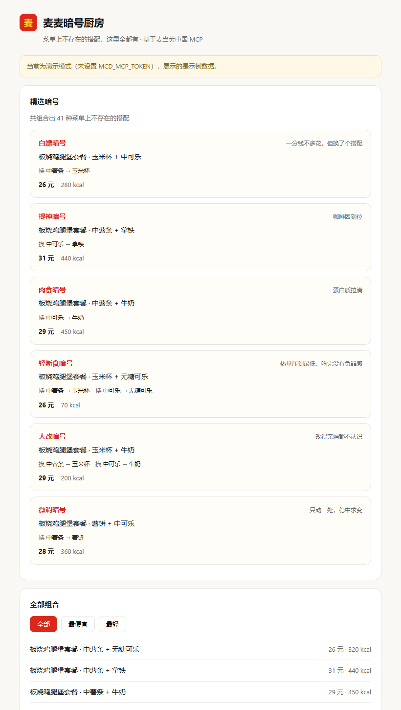

# 麦麦暗号厨房 · McSecret Kitchen

> 菜单上不存在的搭配，这里全都有。
>
> **已在真实麦当劳账户完成联调验证** —— 实测一次组合出 **2216 种**隐藏搭配，热量数据来自官方营养接口（TOON 格式解析）。

基于**麦当劳中国官方 MCP Server** 的隐藏菜单生成器。利用套餐内的**可替换选项**（薯条换玉米杯、可乐换拿铁、加双层牛肉……）做全组合枚举，算出真实价格与热量，给每种搭配起个暗号名。

零第三方依赖，Python 标准库 + 一个 HTML 文件，两个文件跑起来。



## 它解决什么问题

麦当劳的套餐一直可以改配置 —— 薯条换玉米杯、可乐换拿铁、加双层牛肉。但这层能力在官方 App 里是**被动**的：你得自己点进套餐，一组一组试，试完也不知道总价和热量。

本项目把它变成**主动枚举**：一次性把套餐内所有可替换组合摊开，剔除原版，算出价格与热量，挑出有意思的那些并命名。菜单上不存在的搭配，其实一直都在。

## 快速开始

```bash
# 1. 申请 Token：https://open.mcd.cn/mcp （手机号登录 → 控制台 → 激活 → 复制）
# 2. 启动
export MCD_MCP_TOKEN="你的Token"          # Windows: set MCD_MCP_TOKEN=你的Token
python mcd_secret_kitchen.py
# 3. 浏览器打开 http://127.0.0.1:8849
```

**没有 Token 也能直接跑。** 未检测到 `MCD_MCP_TOKEN` 时自动进入演示模式，用示例套餐展示完整效果。

命令行模式：

```bash
python mcd_secret_kitchen.py --scan
```

```
--------------------------------------------------------
  麦麦暗号厨房 · 隐藏菜单
--------------------------------------------------------
  共组合出 41 种菜单上不存在的搭配

  == 精选暗号 ==
  [轻断食暗号] 热量压到最低，吃完没有负罪感
       板烧鸡腿堡套餐 · 玉米杯 + 无糖可乐  |  26 元  |  70 kcal
       换: 中薯条 -> 玉米杯
       换: 中可乐 -> 无糖可乐
  [增肌暗号] 蛋白质和热量一起上
       巨无霸套餐 · 玉米杯 + 无糖可乐 + 加芝士片  |  35 元  |  160 kcal
  [早餐魂暗号] 把薯饼塞进午餐
       板烧鸡腿堡套餐 · 薯饼 + 中可乐  |  28 元  |  360 kcal
--------------------------------------------------------
```

## 暗号规则

| 暗号 | 触发条件 | 一句话 |
|---|---|---|
| 白嫖暗号 | 差价 = 0 | 一分钱不多花，但换了个搭配 |
| 大改暗号 | 替换项 ≥ 2 处 | 改得亲妈都不认识 |
| 微调暗号 | 只替换 1 处 | 只动一处，稳中求变 |
| 提神暗号 | 含咖啡 / 拿铁 / 美式 | 咖啡因到位 |
| 肉食暗号 | 含鸡 / 牛 / 腿 / 翅 / 肉 | 蛋白质拉满 |
| 甜品暗号 | 含派 / 甜筒 / 麦旋风 / 冰 / 芋 | 糖分优先 |
| 轻断食暗号 | 有热量数据且 ≤ 150 kcal | 热量压到最低，吃完没有负罪感 |

真实环境实测（麦乐送门店）一次可组合出 **2000+ 种**菜单上不存在的搭配。

## 用到的 MCP Tool

| Tool | 作用 |
|---|---|
| `query-meals` | 拉取当前门店可售餐品列表 |
| `query-meal-detail` | **核心**：读取套餐组成及每项的可替换选项 |
| `calculate-price` | 计算自定义搭配的应付总价 |
| `list-nutrition-foods` | 提供热量等营养数据 |
| `query-nearby-stores` | 确定门店上下文 |

完整调用链路见 [MCP_INTEGRATION.md](MCP_INTEGRATION.md)。

## 项目结构

```
mcd-secret-kitchen/
├── mcd_secret_kitchen.py    # MCP 客户端 + 组合引擎 + 本地服务（单文件，零依赖）
├── web/index.html           # 前端单页
├── skill/SKILL.md           # WorkBuddy Skill 定义
├── CONTEST_DECLARATION.md   # 参赛声明（官方原文，不可改动）
├── MCP_INTEGRATION.md       # MCP 接入说明
└── workbuddy.md             # WorkBuddy 开发对话记录
```

## 设计取舍

- **零依赖**：只用标准库，`python mcd_secret_kitchen.py` 即跑。
- **跳过全默认组合**：全默认就是原版套餐，不算隐藏菜单。这一步曾因类型不一致（dict 列表 vs 字符串列表）而失效，已修复。
- **套餐详情只取前 8 个**：控制 MCP 调用次数，避开 600 次/分钟限流。
- **字段模糊匹配**：`find_rows()` / `pick()` 兼容 MCP 各版本的字段命名差异，升级后无需改代码。
- **绝不自动下单**：只做组合推荐，下单必须用户显式确认。

## 免责声明

本项目是麦当劳程序员创意开发大赛参赛作品，由参赛者独立开发，**非麦当劳官方产品**。输出仅供参考，餐品信息、价格、供应状态与可替换选项以麦当劳官方渠道实时结果为准。Token 仅从环境变量读取，不包含在任何文件中。

## License

MIT
